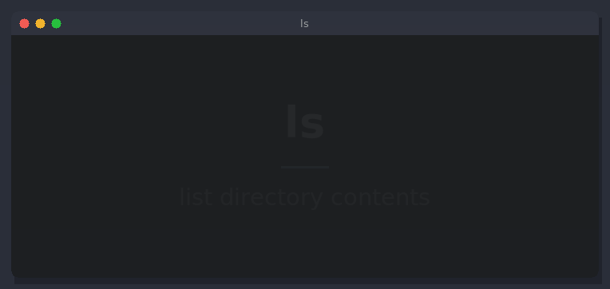

# autodemo

Scripted, non-interactive demo recorder for GitHub READMEs. You write a small `*.demo` script,
autodemo drives the program (typed keys, simulated mouse pointer, captions, slides, transitions)
and renders an **animated WebP** (or mp4/webm). Written in C, links freetype + libwebp.

## Status (honest)

| Part | State |
|---|---|
| Script parser, `check` | done, tested |
| TUI/CLI backend (private tmux + software renderer) | done, tested on `ls`, frost, lazytui |
| Animated WebP (libwebp anim encoder, frame dedup, lossless or lossy) | done |
| mp4 / webm via ffmpeg | done (needs ffmpeg) |
| `preview` (ASCII key screens) | done |
| GUI backend (headless Wayland compositor + wtype + grim) | NOT implemented; `window gui` errors out |
| Web backend (headless Firefox screenshots) | NOT implemented; `window web` errors out |
| Emacs mode | not started; the format is plain line-based on purpose |

Limits: wide (CJK) glyphs take one cell, no italics, no blinking cursor, no bold face for
non-ASCII fallback, text fonts are DejaVu (override the mono font with `AUTODEMO_FONT=/x.ttf`).
Recording is real time (a 10 s demo takes ~10 s). Per-run temp dirs `/tmp/autodemo-home-*`
are left behind (tiny); delete them yourself.

## Usage

    make
    ./autodemo check   x.demo
    ./autodemo render  x.demo -o out.webp [-q N] [--snap MS frame.ppm] [-v]
    ./autodemo preview x.demo

`-q 0` (default) is lossless; terminal frames are flat colour so lossless is already about as small
as lossy. `.mp4`/`.webm` output goes through ffmpeg. `--snap` dumps the frame shown at MS as PPM
(handy for looking at the result without a player).

Everything runs with a private `HOME` (and XDG dirs) and a private tmux server: your real configs and
sessions are never touched. `setup` lines prepare files in that HOME.

## Script format

One command per line, `#` comments, `"quoted strings"` with `\n \" \e` escapes.
`run`, `setup`, `cd`, `env` take the rest of the line verbatim.

Header directives (apply to the whole demo, position does not matter):

    size 100x30          terminal cells (default 100x30)
    theme dark|light|dracula
    font 15              pixel size of the monospace font (cell size follows)
    fps 10               sampling rate while waiting
    title "text"         window title (default: the run command)
    window tui           tui is the only implemented backend
    env KEY=VALUE        env for the program      cd DIR   working dir
    loop                 loop forever (default: play once)

Timeline commands:

    setup SHELL-CMD              run before/while recording, in the private HOME (create fixtures)
    run CMD                      start the program in the terminal (a shell works too: run bash -i)
    type "text" [ms-per-char]    human-like jittered typing; "\n" is Enter
    key Enter C-c Down*3 ...     tmux key names; NAME*N repeats
    wait 500ms | 2s
    caption "text" [top|bottom]  persistent overlay until `caption off`
    slide "title" ["subtitle" [2s]]
    transition fade|slide|none [300ms]   used when entering/leaving slides
    cursor move X Y [ms]         simulated mouse pointer, X Y in cells, eased
    cursor click                 ripple + SGR mouse press/release sent to apps that enabled mouse reporting
    cursor hide | show

## Sizes (all lossless WebP unless noted)

| demo | size | length |
|---|---|---|
| examples/ls.demo (80x16) | ~46 KiB | 8.9 s |
| examples/frost.demo (100x28) | ~22 KiB | 5.6 s |
| examples/lazytui.demo (110x34, constantly animating UI) | ~550 KiB (webm VP9: ~290 KiB) | 10.5 s |

Static-ish terminals compress to tiny files because only changed regions of changed frames are stored;
a UI that animates every frame is the worst case.

## Design

    script -> Cmd list -> executor --tick--> tmux capture-pane -e -> ANSI/SGR grid
                                              -> software renderer (FreeType) layer
                                              -> overlays (caption, pointer) -> frame
                                              -> dedup -> WebPAnimEncoder / ffmpeg

Backend interface for phase 2: a backend turns input events into either a cell grid (tui) or a pixel
image (gui via `WLR_BACKENDS=headless` compositor + `wtype` + `grim`; web via headless Firefox);
the overlay/transition/encoder stages already work on plain RGBA images.

## Tests

    make test
